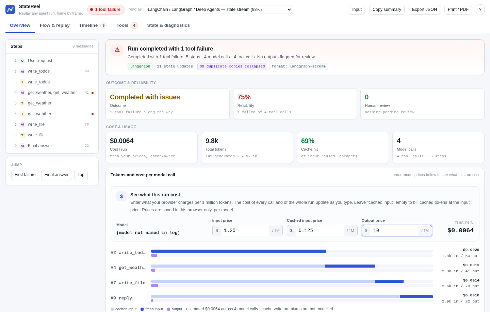
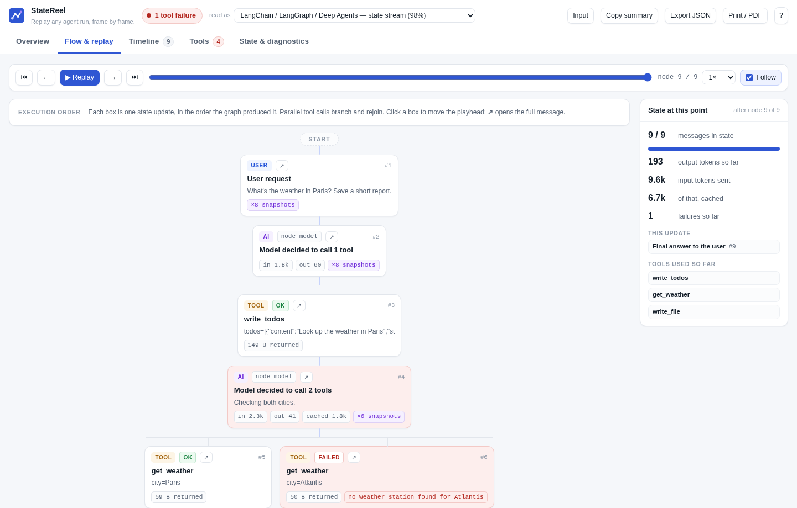

# StateReel

**Replay any agent run, frame by frame.**

Paste your agent's debug log and get a readable run report.

When an agent breaks, its debug output is a wall of
`[values] {'messages': [HumanMessage(content=...), AIMessage(content='', tool_calls=[...` on one line, repeated for every step.
StateReel turns that into an overview, a step-by-step replay of the run, and a searchable timeline, for most agent frameworks, entirely in your browser.



## Use it

There's nothing to install and nothing to build.

- **Online:** open [bharathk01.github.io/statereel](https://bharathk01.github.io/statereel/).
- **Offline:** download `statereel.html` from [Releases](../../releases) and double-click it. It opens in any modern browser, with no internet needed.

### How to use

1. **Get a log.** Run your agent with its debug or verbose output on (see [Supported frameworks](#supported-frameworks)), then copy what it printed, or save it to a file.
2. **Load it.** Paste it into the box, click **Open file…**, or drop the file anywhere on the page.
3. **Build report.** Press **Build report** (or Ctrl/Cmd+Enter).
4. **Read it.** Start with **Overview** for the outcome, failures, tokens and cost. Use **Flow & replay** to step through the run, and **Timeline** to search every message and tool call.
5. **Optional:**
   - Enter your model's prices per 1M tokens to see what the run cost.
   - Switch the **read as** menu if the format was guessed wrong.
   - Use **Copy summary**, **Export JSON** or **Print / PDF** to share the result.

Not sure what a log looks like? Pick one from **Load a sample**. If you paste something that isn't an agent log (a file path, a URL, an error traceback), StateReel says so and suggests what to paste instead.

Logs up to tens of megabytes are fine. Big logs are parsed in a background thread and never touch the text box.

## What you get

| View | For |
|---|---|
| **Overview** | Outcome, reliability, how many outputs need human review, tokens, cache hit rate, and cost from your own prices |
| **Flow & replay** | The run step by step in execution order, with parallel tool calls branching, play/pause, and state at each step |
| **Timeline** | Every message, tool call and result, paired and searchable, with failures highlighted |
| **Tools** | Calls, failures and data returned per tool |
| **State & diagnostics** | Non-message state (todos, files), how the log was read, and anything unrecognised |



## Supported frameworks

The format is detected automatically. You can override it from the **read as** menu.

| Framework | How to get a log to paste | Verified with real output |
|---|---|---|
| LangGraph / LangChain / Deep Agents | `graph.invoke(inputs, debug=True)`, or print chunks from `graph.stream(...)` in any `stream_mode` | yes, 7 print styles |
| Claude Agent SDK | `claude -p "..." --output-format stream-json --verbose`, or `print(message)` for each SDK message | yes, via the SDK's own parser |
| CrewAI | `Crew(..., verbose=True)` (both the 1.x panels and the older `# Agent:` markers) | yes, plain and coloured |
| Microsoft AutoGen | `await Console(team.run_stream(task=...))`, or `print()` each message or the `TaskResult` | yes, 3 print styles |
| Google ADK | `print(event)` for each event from `runner.run_async(...)`, `repr(event)`, or `event.model_dump_json()` | yes, 4 print styles |
| Pydantic AI | `print(result.all_messages())` or `result.all_messages_json()` | yes, 3 print styles |
| LlamaIndex, Semantic Kernel, Vercel AI SDK, smolagents, Strands, OpenAI-style chat JSON | print the events, message history or result | from documented formats |

"Verified" means a real agent built on that framework (driven by a scripted fake model, so no API key is needed) was run, its output printed the way developers print it, and the result is checked on every change. Every one of those logs is also replicated into files holding 500 runs, and the counts must stay exact. [COMPATIBILITY.md](COMPATIBILITY.md) lists the exact versions. A weekly job re-runs the captures against the latest releases.

## Privacy

Your log never leaves the page. This is enforced by the browser, not just promised: the page's Content-Security-Policy blocks every network request (`default-src 'none'`), and the test suite checks that. Your log is also cleared when you leave the page: closing, reloading or navigating away always brings you back to an empty page. The only thing stored is the model prices you type, in your browser's local storage.

Before sharing a log anywhere else, remember that agent logs often contain prompts, file contents and keys.

## Develop

The whole app is one HTML file (`statereel.html`), with no dependencies and **no build step**. Edit it and reload the browser.

```bash
pip install -r requirements-dev.txt          # Playwright + the real-capture tooling
python -m playwright install chromium
tests/run-all.sh                             # parser, insight, cost and real-capture tests + browser e2e
node tests/notlog.test.js                    # accidental-paste detection
python tools/capture/langgraph_deepagents.py # re-capture real framework output (no API key);
                                             # one script per framework in tools/capture/,
                                             # CrewAI from its own env: requirements-crewai.txt
python tools/update_compat.py                # refresh COMPATIBILITY.md from the captures
python tools/screenshots.py                  # refresh the README screenshots
```

[ARCHITECTURE.md](ARCHITECTURE.md) explains how parsing works across frameworks, and [CONTRIBUTING.md](CONTRIBUTING.md) covers adding a framework or handling a format change.

## Publish your own copy

1. Push this repository to GitHub.
2. In **Settings → Pages**, set **Source** to **GitHub Actions**. Every push to `main` deploys `statereel.html` as the site (`pages.yml`).
3. To publish a downloadable file, tag a version: `git tag v1.0.0 && git push --tags`. `release.yml` attaches `statereel.html` to a GitHub Release.

`ci.yml` runs the tests on every push and pull request. `compat.yml` re-checks the frameworks against their latest releases every week.

## License

[MIT](LICENSE)
