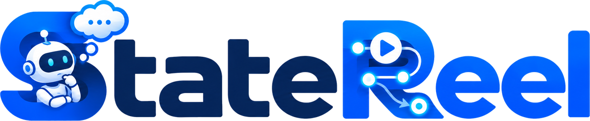
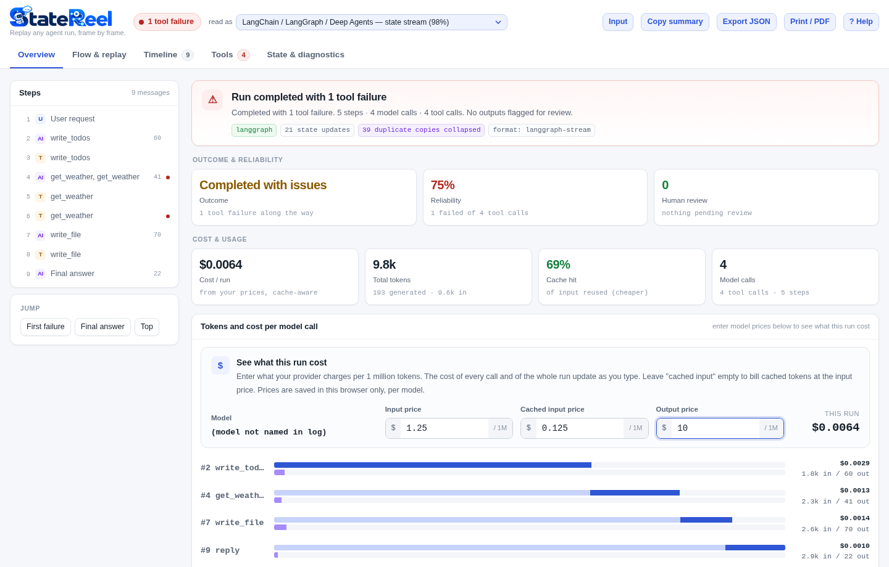
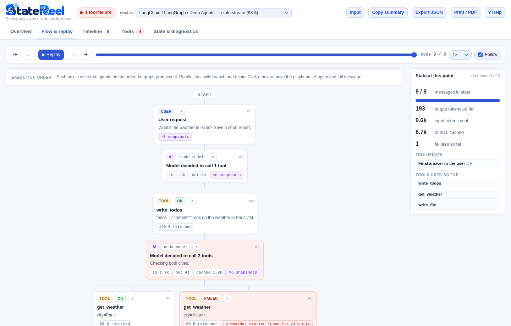

<h1 align="center">
  <picture>
    <source media="(prefers-color-scheme: dark)" srcset="assets/brand/logo-dark.png">
    
  </picture>
</h1>

<p align="center"><b>Replay any agent run, frame by frame.</b></p>

Paste your agent's debug log and get a readable run report.

When an agent breaks, its debug output is a wall of
`[values] {'messages': [HumanMessage(content=...), AIMessage(content='', tool_calls=[...` on one line, repeated for every step.
StateReel turns that into an overview, a step-by-step replay of the run, and a searchable timeline, for most agent frameworks, entirely in your browser.



## When to use it

StateReel is built for developers working on agentic systems on their own machine.

- **Your agent failed and you need to know why.** Turn on the framework's debug or verbose mode and the log fills with huge JSON blobs or one-line message lists, repeated for every step. Paste the log into StateReel to see the run in order, which tool call failed, what the agent saw just before, and how it recovered or didn't.
- **You want to understand how an agent actually works.** Step through the flow in **Flow & replay**: which node ran, which tools it called in parallel, what came back, and how the state grew step by step. It's also useful for learning a new framework or reviewing a colleague's agent.
- **You need numbers for a run.** The Overview shows model calls, tool calls, token usage, cache hits and failures. Enter your provider's price per 1M tokens to get the cost of each model call and of the whole run.
- **You want totals across several runs.** Paste or open a log that contains several runs back to back, and the report gives combined calls, tokens and cost across all of them. This is handy for a rough cost estimate per batch or per day. Side-by-side comparison of individual runs isn't built in yet.
- **The logs are confidential.** Everything runs locally in the browser. Download `statereel.html` once and open it offline. Nothing is uploaded, no account is needed, and the log is cleared when you close the page. That makes it safe for client or production data, within your organisation's own data rules.

## Use it

There's nothing to install and nothing to build.

- **Online:** open [bharathk01.github.io/statereel](https://bharathk01.github.io/statereel/).
- **Offline:** download `statereel.html` from [Releases](../../releases) and double-click it. It opens in any modern browser, with no internet needed.

### How to use

1. **Get a log.** Run your agent with its debug or verbose output on (see [Supported frameworks](#supported-frameworks)), then copy what it printed, or save it to a file.
2. **Load it.** Paste it into the box, click **Open file…**, or drop the file anywhere on the page.
3. **Build report.** Press **Build report** (or Ctrl/Cmd+Enter).
4. **Read it.** Start with **Overview** for the outcome, failures, tokens and cost. Use **Flow & replay** to step through the run, and **Timeline** to search every message and tool call.
5. **Optional:**
   - Enter your model's prices per 1M tokens to see what the run cost.
   - Switch the **read as** menu if the format was guessed wrong.
   - Use **Copy summary**, **Export JSON** or **Print / PDF** to share the result.

Not sure what a log looks like? Pick one from **Load a sample**. If you paste something that isn't an agent log (a file path, a URL, an error traceback), StateReel says so and suggests what to paste instead.

Logs up to tens of megabytes are fine. Big logs are parsed in a background thread and never touch the text box.

## What you get

| View | For |
|---|---|
| **Overview** | Outcome, reliability, how many outputs need human review, tokens, cache hit rate, and cost from your own prices |
| **Flow & replay** | The run step by step in execution order, with parallel tool calls branching, play/pause, and state at each step |
| **Timeline** | Every message, tool call and result, paired and searchable, with failures highlighted |
| **Tools** | Calls, failures and data returned per tool |
| **State & diagnostics** | Non-message state (todos, files), how the log was read, and anything unrecognised |



## Supported frameworks

The format is detected automatically. You can override it from the **read as** menu.

| Framework | How to get a log to paste | Tested versions (as of 2026-10-09) |
|---|---|---|
| LangGraph / LangChain / Deep Agents | `graph.invoke(inputs, debug=True)`, or print chunks from `graph.stream(...)` in any `stream_mode` | langgraph 1.2.14, langchain 1.4.4, langchain-core 1.6.9, deepagents 0.7.23 (7 print styles) |
| Claude Agent SDK | `claude -p "..." --output-format stream-json --verbose`, or `print(message)` for each SDK message | claude-agent-sdk 0.2.165 (2 print styles) |
| CrewAI | `Crew(..., verbose=True)` (both the 1.x panels and the older `# Agent:` markers) | crewai 1.15.26 (plain and coloured) |
| Microsoft AutoGen | `await Console(team.run_stream(task=...))`, or `print()` each message or the `TaskResult` | autogen-agentchat 0.7.5 (3 print styles) |
| Google ADK | `print(event)` for each event from `runner.run_async(...)`, `repr(event)`, or `event.model_dump_json()` | google-adk 2.11.0 (4 print styles) |
| Pydantic AI | `print(result.all_messages())` or `result.all_messages_json()` | pydantic-ai-slim 2.54.0 (3 print styles) |
| LlamaIndex, Semantic Kernel, Vercel AI SDK, smolagents, Strands, OpenAI-style chat JSON | print the events, message history or result | from documented formats, not yet pinned to a version |

"Tested versions" means a real agent was built on that framework (driven by a scripted fake model, so no API key is needed), its output was printed the way developers print it, and the result is checked on every change. Every one of those logs is also replicated into files holding 500 runs, and the counts must stay exact. Older versions usually work too, because the parser recognises both old and new field names. [COMPATIBILITY.md](COMPATIBILITY.md) has the full list.

### Keeping up with new framework versions

Agent frameworks change their log formats often. Spotting a change is automated; the fix is done by hand.

1. **Weekly check (automated).** Every Monday, the `compat` workflow installs the latest release of each framework, runs the same scripted agents, and checks that StateReel still reads them correctly. You can also start it any time from **Actions → compat → Run workflow**.
2. **Alert (automated).** If a check fails, GitHub opens an issue listing the framework versions tested and the failing checks, for example the log file and the count that no longer matches. Inside the app, **State & diagnostics** also lists any message types it didn't recognise, which usually points straight at the new format.
3. **Fix (manual).** A maintainer adds the new type or field name to the parser, usually a one-line rule, and commits the new capture next to the old one, so both versions stay supported. `tools/update_compat.py` then regenerates `COMPATIBILITY.md`, and the version table above is updated by hand.

**Planned, not built yet:** an opt-in "check for updates" notice in the app telling you when a newer StateReel supports more framework versions. The app makes no network requests today, so this would only ever run if you turn it on.

## Privacy

Your log never leaves the page. This is enforced by the browser, not just promised: the page's Content-Security-Policy blocks every network request (`default-src 'none'`), and the test suite checks that. Your log is also cleared when you leave the page: closing, reloading or navigating away always brings you back to an empty page. The only thing stored is the model prices you type, in your browser's local storage.

Before sharing a log anywhere else, remember that agent logs often contain prompts, file contents and keys.

## Develop

The whole app is one HTML file (`statereel.html`), with no dependencies and **no build step**. Edit it and reload the browser.

```bash
pip install -r requirements-dev.txt          # Playwright + the real-capture tooling
python -m playwright install chromium
tests/run-all.sh                             # parser, insight, cost and real-capture tests + browser e2e
node tests/notlog.test.js                    # accidental-paste detection
python tools/capture/langgraph_deepagents.py # re-capture real framework output (no API key);
                                             # one script per framework in tools/capture/,
                                             # CrewAI from its own env: requirements-crewai.txt
python tools/update_compat.py                # refresh COMPATIBILITY.md from the captures
python tools/screenshots.py                  # refresh the README screenshots (assets/screenshots/)
```

### Project layout

```
statereel.html          the whole app: one self-contained file, works offline
assets/
  brand/                logo.png, logo-dark.png (README), favicon.ico; the app embeds its own copies
  screenshots/          images used in this README (generated)
tests/                  parser, insight, cost, scale and browser tests
  fixtures/real/        real output captured from each framework
tools/
  capture/              one script per framework to re-capture real output
  screenshots.py        builds assets/screenshots
  update_compat.py      regenerates COMPATIBILITY.md
  scan_private.py       blocks private terms and secrets from being published
.github/workflows/      ci (tests), pages (website), release (download), compat (weekly)
```

[ARCHITECTURE.md](ARCHITECTURE.md) explains how parsing works across frameworks, and [CONTRIBUTING.md](CONTRIBUTING.md) covers adding a framework or handling a format change.

## Publish your own copy

1. Push this repository to GitHub.
2. In **Settings → Pages**, set **Source** to **GitHub Actions**. Every push to `main` deploys `statereel.html` as the site (`pages.yml`).
3. To publish a downloadable file, tag a version: `git tag v1.0.0 && git push --tags`. `release.yml` attaches `statereel.html` to a GitHub Release.

`ci.yml` runs the tests on every push and pull request. `compat.yml` re-checks the frameworks against their latest releases every week.

## License

[MIT](LICENSE)
